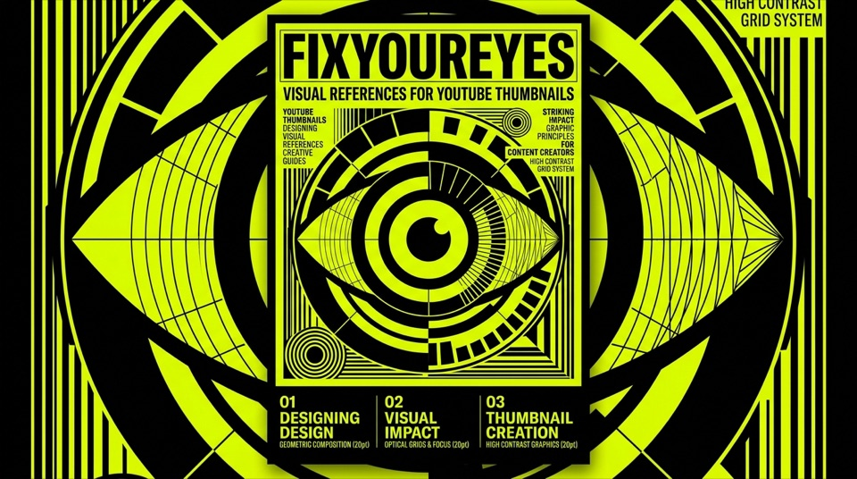

# FIXYOUREYES — YouTube Thumbnail Reference System & Editorial Direction

<p align="center">
  
</p>

> **"Why can a cover of *The New Yorker*, *Monocle*, or a 1968 Swiss exhibition poster capture your gaze instantly without shouting, while on YouTube it seems mandatory to look desperate?"**  
> An editorial research experiment and art-directed visual vault of 64 Swiss-designed thumbnail reference systems for thoughtful YouTube creators, educators, and essayists.

[](https://fixyoureyes.netlify.app)
[](https://github.com/emaf205/FIXYOUREYES)
[](LICENSE)

---

## ✦ What This Experiment Is

This is not a traditional software repository: it is an **editorial experiment and visual research archive**.

The foundational hypothesis: **Can independent magazine covers, modernist typography, and Swiss graphic design rescue YouTube thumbnails from the toxic mediocrity of clickbait, uniting calibrated AI prompting with genuine art direction?**

The purpose of this repository is the **methodology itself**: documenting the creative journey, architectural mockups, edge-case debugging, and behind-the-scenes pair-programming workflows between human art direction and Google Antigravity. The live interactive web application is deployed on Netlify.

---

## ✦ Live Interface & Feed Architecture

<p align="center">
  
</p>

<p align="center">
  
  
</p>

---

## ✦ The Problem: The Visual Grotesquerie of YouTube

Open the YouTube homepage on any given day. You are greeted by a grotesque visual carnival: bulging eyes, agape mouths frozen in fake shock, neon-red arrows pointing at nothing, thick white sticker cutouts, and hyper-saturated yellow-blue gradients shouting for attention.

Does it work for cheap clickbait? Perhaps, if your business model is monetizing emptiness. But if you produce thoughtful content—video essays, deep architectural breakdowns, tech policy analysis, longform cultural podcasts, or educational masterclasses—that aesthetic sabotages your authority before the viewer even presses play. It broadcasts insecurity and desperation.

Editorial graphic design does not rely on hysteria:
- **Visual tension** over sensory overload.
- **Disciplined geometric grids** over chaotic element stacking.
- **Controlled, noble color palettes** over neon soup.
- **The psychological weight of a sharp conceptual metaphor**.

When generative AI tools arrived (ChatGPT, Midjourney, Flux, Stable Diffusion), most creators simply used them to generate even uglier thumbnails: plastic skin, hyper-glossy fake robots, generic cyberpunk skyscrapers, and fictional financial charts. The problem was never the AI. The problem was the **complete absence of art direction**.

---

## ✦ The Solution: The 64 Reference Vault

FIXYOUREYES treats every YouTube thumbnail as if it were the cover of an independent monograph or cultural broadsheet:
1. **Native 16:9 Aspect Ratio**: Every visual reference is built strictly for the 16:9 landscape canvas, eliminating awkward mobile letterboxing.
2. **Quantized Color Palettes**: Precise hex breakdowns (pure graphite, warm paper `#fbf8f3`, acid yellow `#dfff00`, international Klein blue, rich carmine).
3. **Calibrated Prompt DNA**: Exact prompt formulas ready to copy into ChatGPT, Midjourney, or Flux, tuned to generate editorial imagery without plastic AI artifacts.
4. **Swiss Layout Archetypes**:
   - *Archetype 01: Swiss Grid & Optical Balance*
   - *Archetype 02: Editorial Broadsheet & Asymmetric Tension*
   - *Archetype 03: Minimal Stripe & High-Contrast Telemetry*

<p align="center">
  
  
  
</p>

---

## ✦ Technical Highlights & Architecture

```text
FIXYOUREYES/
├── index.html           # 16:9 single-column Swiss stream
├── style.css            # High-density typography scales, sticky header
├── app.js               # Reactive modal inspection and prompt copy engine
├── assets/              # High-resolution 16:9 references and design studies
└── README.md            # Experiment manifesto
```

- **Zero Frameworks**: Pure HTML5, modern CSS variables, and vanilla ES6+.
- **Instant Keyboard Shortcuts**: Press <kbd>Esc</kbd> to close inspection, <kbd>C</kbd> to copy prompt modifiers, arrow keys to navigate references.
- **100/100 Lighthouse**: 0ms layout shift, optimized WebP/PNG assets.

---

## ✦ Author & Philosophy

Designed and documented by **[Emanuele BDC](https://emaf205.com)** in Milan.  
An intentional declaration against visual noise and generic AI slop.

Distributed under the **MIT License**. Free for educators, essayists, and creative technologists.
