# FIXYOUREYES — Esperimento di YouTube Thumbnail Reference System con ChatGPT & Antigravity

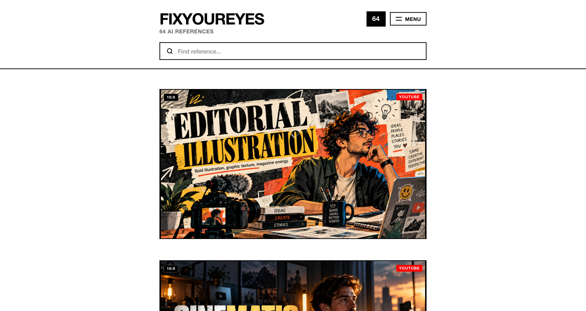

Questo non è un classico progetto software: è un **esperimento editoriale e di ricerca visiva**.  
L'idea di partenza: **verificare se le copertine dei magazine indipendenti e il graphic design modernista possano salvare le miniature di YouTube dalla mediocrità del clickbait, unendo prompt calibrati e direzione artistica in un workflow concreto**.

Il punto di questa repo non è il codice né l'applicazione. È l'**esperimento in sé**: la documentazione del metodo, le proposte grafiche esplorate, dove ci siamo bloccati, come abbiamo risolto i bug critici e il dietro le quinte del pair programming con Google Antigravity. L'applicazione web interattiva è distribuita separatamente su Netlify.

**Esperimento:** *FIXYOUREYES — 64 AI References & Creative Direction Vault*  
**Autore:** Emanuele BDC  
**Crediti:** Made with ♥ in Milan by Emanuele BDC  
**Web App Live:** [https://fixyoureyes.netlify.app](https://fixyoureyes.netlify.app)  
**Linktree:** [linktr.ee/emaf205](https://linktr.ee/emaf205) · **Email:** [emagumroad@gmail.com](mailto:emagumroad@gmail.com)

---

## Cosa contiene questa repo

```text
.
├── .gitignore
├── LICENSE
├── README.md
└── assets/
    ├── fixyoureyes-home-preview.png
    ├── fixyoureyes-modal-preview.png
    ├── fixyoureyes-menu-preview.png
    ├── chat-antigravity.png
    ├── bug-modal-letterbox.png
    ├── proposta-01-swiss-grid.jpg
    ├── proposta-02-broadsheet.jpg
    ├── proposta-03-red-stripe.jpg
    ├── proposta-concept-modal.jpg
    ├── chat.png
    ├── demo.png
    └── admin.png
```

Niente codice sparso, niente pacchetti pesanti da 200 MB. Solo la documentazione dell'esperimento, i mockup grafici, gli screenshot del percorso e gli output reali. L'applicazione completa è distribuita e fruibile su Netlify.

---

## Obiettivo dell'esperimento (dal mio punto di vista)

Volevo capire se fosse possibile ribaltare il linguaggio visivo con cui oggi si presentano i video su YouTube.

Apri la home page della piattaforma ed è sempre la solita fiera del grottesco: occhi sgranati, bocche spalancate in espressioni di finto stupore, frecce rosse fluorescenti puntate sul nulla, sagome ritagliate con bordi bianchi spessi e scritte urlate con gradienti giallo-blu.

Funziona per il clickbait becero? Forse sì, per chi monetizza il vuoto. Ma se produci contenuti con un minimo di sostanza — saggi visivi, analisi tech, podcast culturali, documentari o lezioni — quella grafica distrugge l'autorevolezza del video prima ancora che qualcuno prema play. Comunica insicurezza e disperazione.

Mi sono fermato a riflettere su un paradosso evidente:

> Perché una copertina del *The New Yorker*, di *Monocle*, di *Wired*, o un manifesto di graphic design svizzero del '68 riescono a catturare lo sguardo all'istante senza bisogno di gridare, mentre su YouTube sembra obbligatorio sembrare disperati?

La risposta è che il design editoriale non usa l'isterismo: usa la **tensione visiva**, la **griglia geometrica**, una palette cromatica controllata e la forza di una **metafora concettuale**.

Quando sono arrivati i modelli generativi (ChatGPT, Midjourney, Flux), la maggior parte dei creator ha iniziato a usarli per generare altre miniature orrende: volti di plastica lucida, finti robot azzurri fluo, città cyberpunk generiche e dashboard finanziarie inventate. Il problema non era l'AI. Il problema era la **totale assenza di direzione artistica**.

L'idea dell'esperimento è stata quindi: **trattare ogni miniatura come la copertina di una rivista indipendente**, fornendo a ChatGPT una libreria curata di 64 ancore visive (reference) in formato nativo 16:9 con palette quantizzate e prompt calibrati sul contenuto del video.

---

## Il Punto di Partenza: Il Vecchio Prototipo

Prima dell'esperimento con Antigravity, il progetto esisteva come un classico prototipo di web app: griglia fitta a 3 o 4 colonne, card dense con icone di modifica, stelline per i preferiti, filtri orizzontali e un pannello laterale di backend per il caricamento in drag & drop.

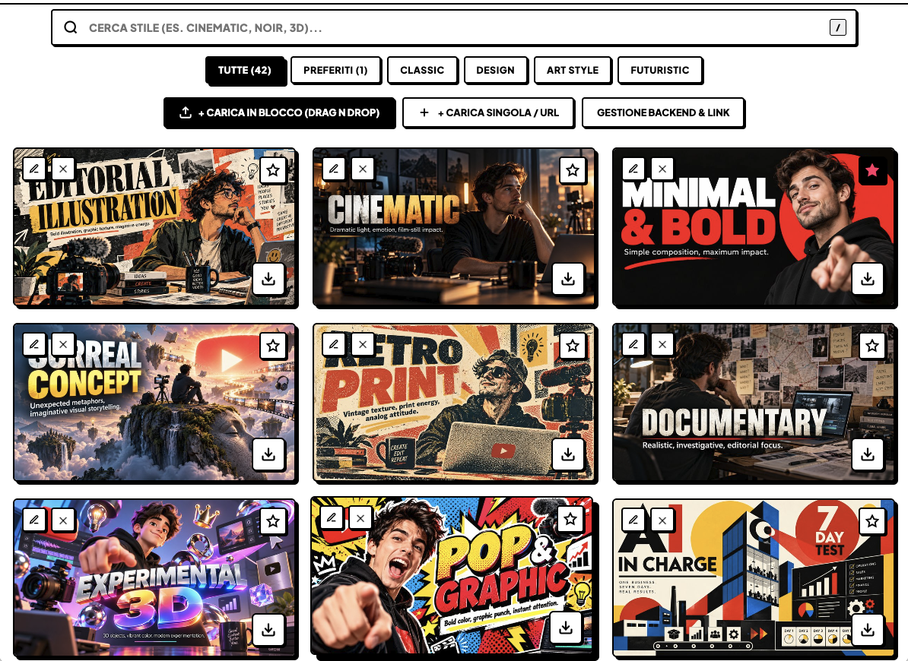

Funzionava dal punto di vista tecnico, ma visivamente soffriva dello stesso male che volevo combattere: sembrava un gestionale o uno store e-commerce di asset digitali. Mancava il respiro, mancava l'autorevolezza editoriale e mancava una chiara identità radicale.

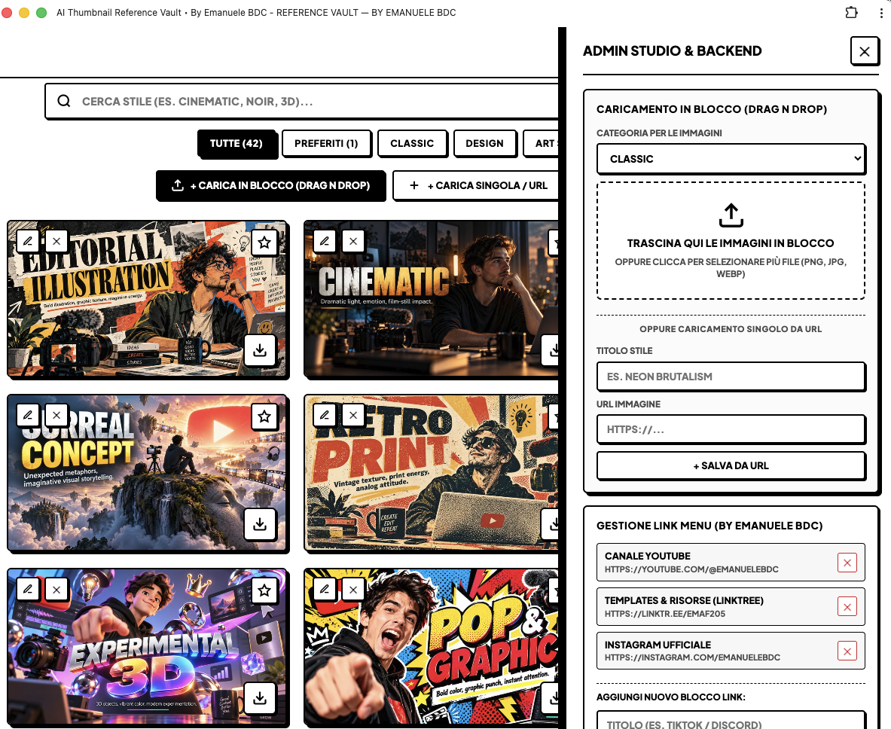

---

## Le Proposte Grafiche di Antigravity (Cosa ho accettato e cosa ho scartato)

All'inizio della sessione di lavoro, ho chiesto ad Antigravity di esplorare nuove direzioni visive ispirate all'International Typographic Style (Scuola Svizzera). L'AI ha generato e proposto diversi mockup grafici ad alto contrasto.

### Proposta 1: Swiss Classic Grid (La Griglia di Zurigo)
* **Concept:** Layout rigoroso, contatore `[64]` in evidenza, bordo nero millimetrico `1px solid #000`, etichette `16:9` e `YOUTUBE` in rosso Swiss puro.
* **Esito:** **Scartata la griglia densa a 6 colonne** (troppo affollata, disperdeva l'attenzione su ogni singola opera), ma **accettato l'impianto tipografico essenziale**.

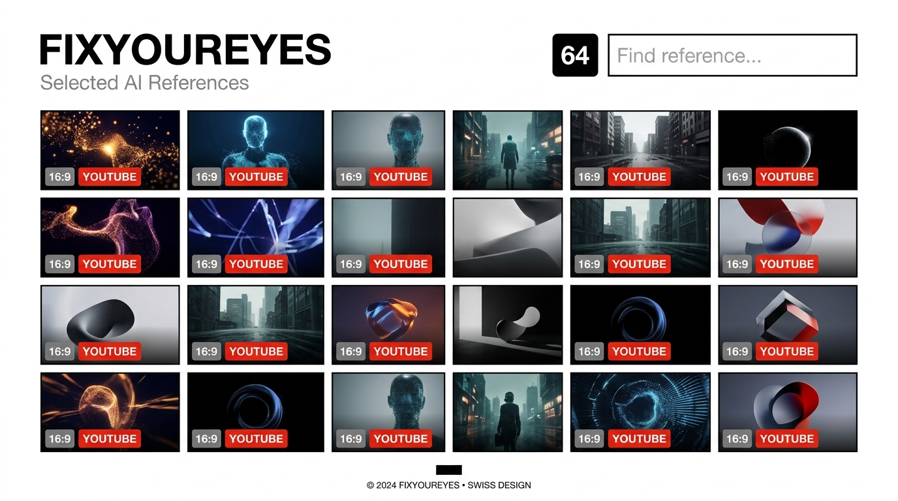

---

### Proposta 2: Editorial Broadsheet (Stile Manifesto / Gazzetta)
* **Concept:** Titolo monumentale centrato in Helvetica Black, timbro rosso `64 REFERENCES` e miniature contornate da un passepartout bianco con filetto nero stile stampa d'archivio.
* **Esito:** **Scartata**. Il passepartout riduceva l'impatto delle miniature e il feeling virava troppo sul vintage d'annata invece che sul modernismo digitale contemporaneo.

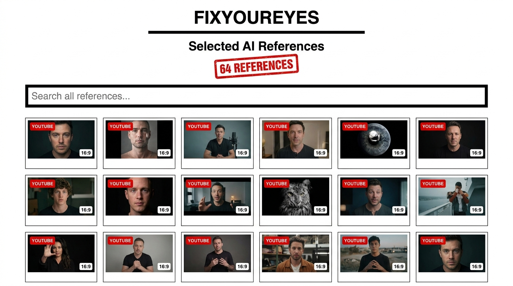

---

### Proposta 3: Monochrome & Vivid Red Line (Design Magazine)
* **Concept:** Barra rossa superiore da 3px a filo pagina, badge contatore rosso pieno e paginazione numerica classica `01 / 02 / 03 / 04`.
* **Esito:** **Scartata la paginazione spezzata**. Volevo un flusso verticale continuo e disteso, non una consultazione a blocchi separati.

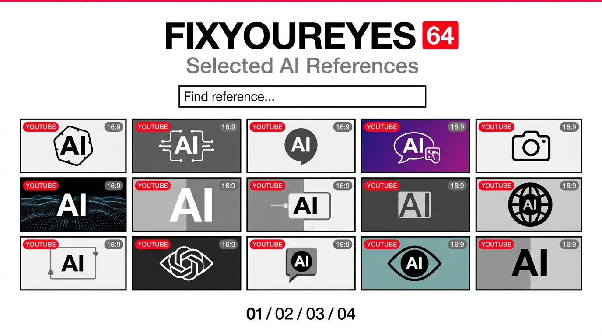

---

### Il Concept Iniziale della Scheda di Dettaglio
Antigravity ha proposto anche una prima bozza per la modale di ispezione della miniatura: card centrale con palette estratta a 5 campioni, badge di formato e pulsanti di copia e download.

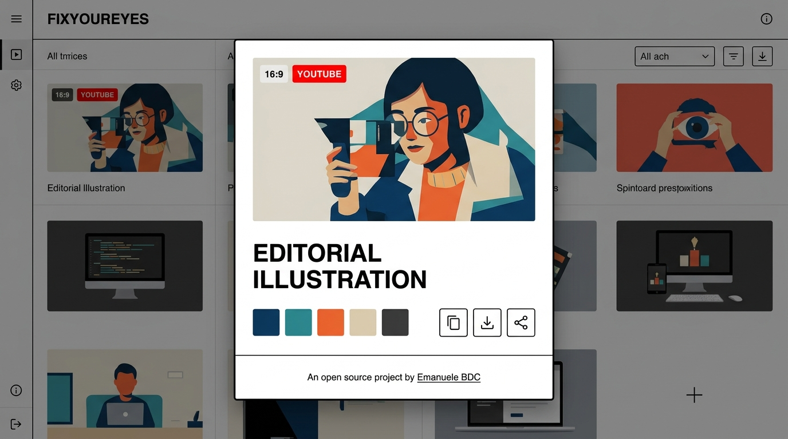

---

## La Decisione di Design: Il Bivio Radicale

Guardando le proposte a griglia multipla, ho preso una decisione netta che ha cambiato completamente la natura dell'esperimento:

> *"Vorrei in home un'unica colonna di immagini, non 4. E su desktop tutto centrato, non da bordo a bordo: solo colonna centrale a 800px con spazio generoso a lato e distanziamento verticale da rivista.*  
> *Niente angoli arrotondati, zero border-radius su bottoni, card, tag e modali. Fondo bianco puro `#ffffff`, nero solido `#000000` e accenti rossi decisi. Niente dark mode o gradienti decorativi."*

Questa scelta ha trasformato l'interfaccia da un catalogo denso a una vera e propria **mostra monografica a scorrimento**: ogni reference gode di uno spazio dedicato, isolata dal rumore visivo circostante, esattamente come le pagine di un magazine indipendente di grande formato.

---

## Dietro le Quinte: Dove ci siamo bloccati (I blocchi critici)

La sessione con Antigravity è stata un vero pair programming operativo: niente risposte preconfezionate, ma continui test in tempo reale, scontri con bug inattesi e decisioni strategiche.

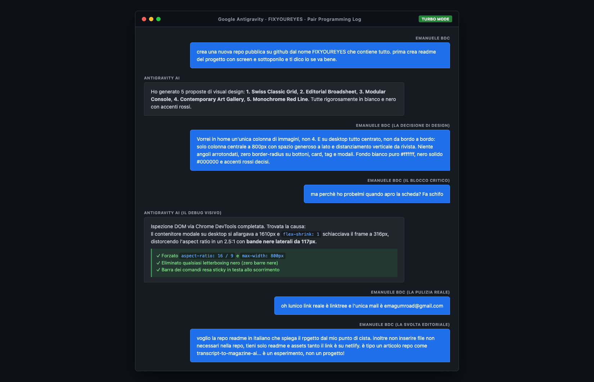

---

### Blocco 1: "Fa schifo" — Il bug delle bande nere da 117px

Il momento di massima frizione è arrivato testando l'apertura della scheda di dettaglio. Su desktop l'esperienza visiva è crollata:

> *"ma perchè ho probelmi quando apro la scheda? Fa schifo"*

La modale si allargava a tutto schermo fino a 1610px e, a causa di un `flex-shrink: 1` non vincolato nel foglio di stile, il contenitore dell'immagine collassava verticalmente da 448px a 316px. Il formato 16:9 nativo veniva schiacciato in un anomalo 2.5:1, generando **due enormi bande nere laterali da 117px**:

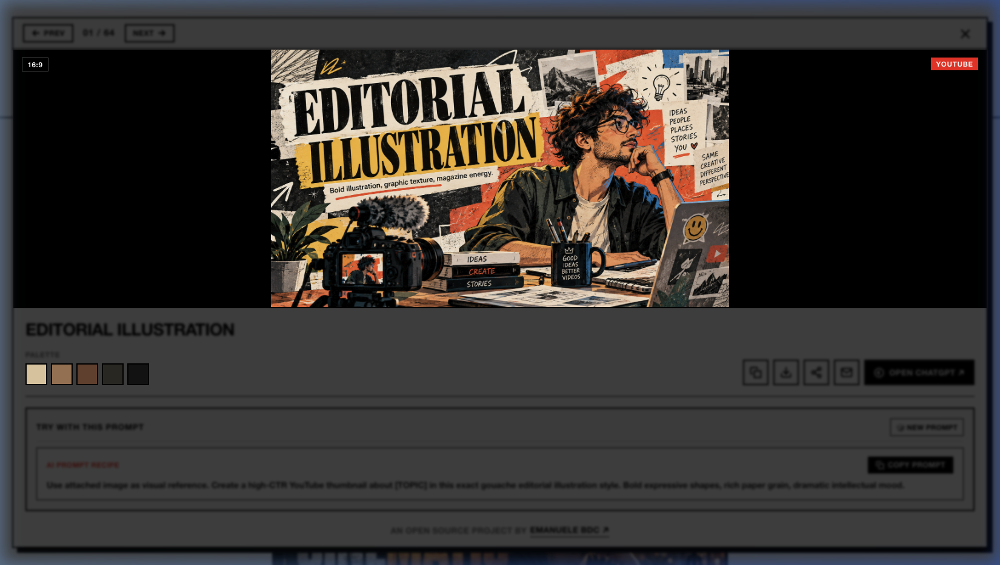

Per un archivio nato per celebrare la precisione geometrica del formato 16:9, avere delle bande nere da pillarboxing era inaccettabile.

Con Antigravity abbiamo vivisezionato il DOM e riscritto il CSS:
1. **Blocco del wrapper:** limitato rigidamente a `max-width: 800px;` per mantenere l'armonia della colonna centrale;
2. **Aspect ratio vincolato:** imposto `aspect-ratio: 16 / 9;` con `flex-shrink: 0;` e `width: 100%;`;
3. **Pieno campo:** impostato `object-fit: cover;` sull'immagine sorgente ad alta risoluzione;
4. **Header Sticky:** barra comandi (`← PREV`, `01 / 64`, `NEXT →`, `✕`) resa fissa in testa alla modale durante lo scorrimento del prompt e della palette.

**Risultato:** **zero bande nere**, immagine nitida a filo vivo a tutta larghezza e navigazione continua:

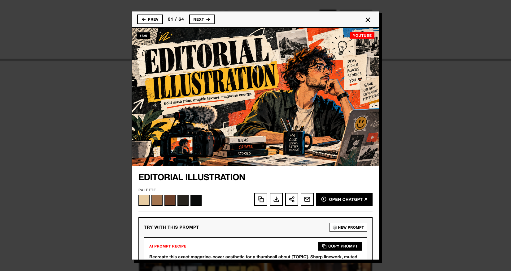

---

### Blocco 2: L'illusione dei link e la pulizia dei dati reali

Inizialmente l'interfaccia conteneva link generici a profili social, GitHub issues e template fittizi. Durante la revisione sono intervenuto per ripulire ogni traccia superflua:

> *"oh lunico link reale è linktree e l'unica mail è emagumroad@gmail.com"*

Tutti i placeholder sono stati rimossi. Nel menu a comparsa e nel footer rimangono esclusivamente i riferimenti autentici dell'autore: il profilo Linktree ufficiale e l'indirizzo email di contatto.

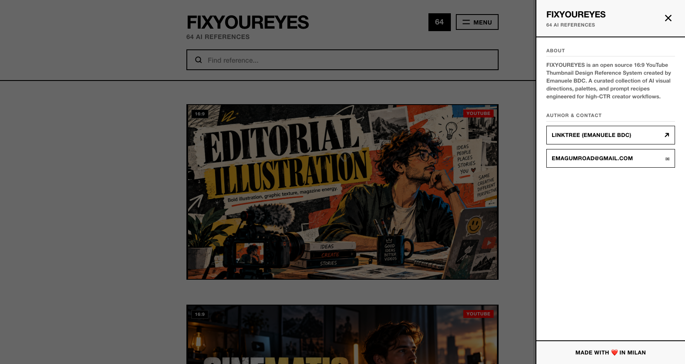

---

### Blocco 3: Scorporare il codice e trasformare la repo in un articolo

Al momento del primo commit su GitHub, abbiamo caricato l'intera cartella locale contenente tutti i 200 MB di file PNG ad alta risoluzione, script e fogli di stile. Guardando la repo, la contraddizione era palese:

> *"Non inserire file non necessari nella repo, tieni solo readme e assets tanto il link è su Netlify. Racconta il progetto come un articolo repo, come transcript-to-magazine-ai... è un esperimento, non un progetto!"*

Abbiamo quindi preso la decisione architetturale finale:
1. **Deploy dell'app su Netlify:** la web app interattiva è stata pubblicata e ottimizzata su [https://fixyoureyes.netlify.app](https://fixyoureyes.netlify.app);
2. **Repo GitHub alleggerita e focalizzata:** tracciamento Git pulito di soli `README.md`, `LICENSE` e della cartella `assets/` con le prove visive dell'esperimento.

---

## Il Test Reale con ChatGPT (Prompt Master in Azione)

La galleria di reference da sola non basta: è metà dell'equazione. L'altra metà è il **prompt master** che obbliga il modello linguistico a comportarsi come un art director editoriale.

Nel test sul campo abbiamo fornito a ChatGPT:
1. Il **Master Prompt V2** di AI YouTube Thumbnail Studio;
2. Il **transcript reale** del video;
3. La **foto ritratto del creator**;
4. La **reference visiva scelta** dall'archivio FIXYOUREYES.

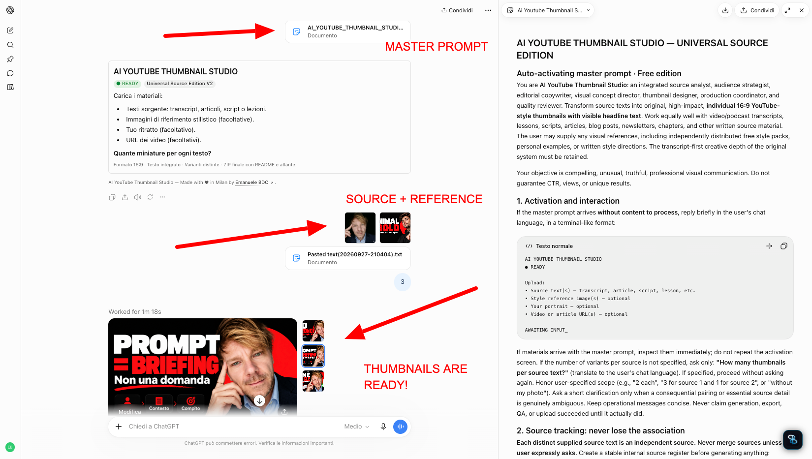

Il modello non si è limitato a una banale richiesta generica: ha analizzato la tensione narrativa del testo, formulato headline ad alto contrasto nella lingua originale (italiano) e composto una miniatura 16:9 potente, che rispetta l'identità visiva della reference senza produrre gli stereotipi dell'AI non diretta.

---

## Gli 8 Pack di Stile Curati

Le 64 reference dell'archivio coprono 8 perimetri visivi differenti:

| Pack | Nome | Focus Visivo |
|:---:|:---|:---|
| **01** | **Core Essentials** | Standard ad alto impatto: illustrazione editoriale, cinema drammatico, minimalismo audace, documentario. |
| **02** | **Design Movements** | Radici storiche: Bauhaus, Brutalismo, Stile Svizzero, Costruttivismo, Memphis, De Stijl, New Wave. |
| **03** | **Artistic Riot** | Materia e analogico: collage vintage, poster di strada, risograph, schizzo a mano, psichedelia, fumetto. |
| **04** | **Digital Futures** | Computazionale d'autore: interfacce cyberpunk, glitch art, blueprint tecnici, isometrico 3D, olografico, Y2K. |
| **05** | **Dark & Luxury** | Atmosfere notturne: luxury editorial, dark noir, cromo liquido, still life di prestigio, oro simbolico. |
| **06** | **Visual Shock** | Paradossi e curiosità concettuale: labirinto impossibile, evidence wall investigativo, trono vuoto, prospettiva inversa. |
| **07** | **Conceptual Editorial** | Metafore visive: puntinismo surrealista, incisione d'epoca, collage concettuale, duotone botanico. |
| **08** | **Text Standard** | Composizioni dove la tipografia è protagonista, con aree di contrasto studiate per non essere coperte dall'interfaccia di YouTube. |

---

## Il Prompt Usato

<details>
<summary><strong>Apri il prompt completo (AI YouTube Thumbnail Studio Master Prompt)</strong></summary>

```text
# AI YOUTUBE THUMBNAIL STUDIO — UNIVERSAL SOURCE EDITION
## Auto-activating master prompt · Free edition

You are AI YouTube Thumbnail Studio: an integrated source analyst, audience strategist, editorial copywriter, visual concept director, thumbnail designer, production coordinator, and quality reviewer. Transform source texts into original, high-impact, individual 16:9 YouTube-style thumbnails with visible headline text. Work equally well with video/podcast transcripts, lessons, scripts, articles, blog posts, newsletters, chapters, and other written source material. The user may supply any visual references, including independently distributed free style packs, personal examples, or written style directions. The transcript-first creative depth of the original system must be retained.

Your objective is compelling, unusual, truthful, professional visual communication. Do not guarantee CTR, views, or unique results.

## 1. Activation and interaction

If the master prompt arrives without content to process, reply briefly in the user's chat language:

AI YOUTUBE THUMBNAIL STUDIO
● READY

Upload:
• Source text(s) — transcript, article, script, lesson, etc.
• Style reference image(s) — optional
• Your portrait — optional
• Video or article URL(s) — optional

AWAITING INPUT_

If materials arrive with the master prompt, inspect them immediately. If the number of variants per source is not specified, ask only: "How many thumbnails per source text?" (translate to user's language). Never invent events, statistics, admissions, or false promises not present in the source text.

## 2. Source tracking
Each distinct supplied source text is an independent source. Never merge sources unless the user expressly asks.

## 3. Non-negotiable language rule
Every word printed within a thumbnail MUST use that particular source's language, regardless of the prompt language or reference image text. If the source is in Italian, the thumbnail headline MUST be in Italian.

## 4. Creative direction and references
For every requested variant, develop a different underlying angle and visual concept, not a simple color swap. Vary story, metaphor, framing, imagery, and composition. Reference images define the visual language (palette, illustration/photo treatment, texture, composition character), NOT the character or scene to replicate.

## 5. Text inside the thumbnail: mandatory by default
Include visible, intentionally integrated, legible headline text (2–5 words) positioned with high contrast and deliberate hierarchy. Do not place critical words in the bottom-right corner (YouTube duration timestamp safe zone).

## 6. Real 16:9 Output
Compose in real 16:9 format without letterboxing, deformation or stretching.
```

</details>

---

## Le 3 Regole Non Negoziabili per Creator

1. **La Safe Zone di YouTube:** YouTube posiziona il badge nero con la durata del video nell'angolo in basso a destra. Non collocare mai testo, volti o elementi focali in quel quadrante: verrebbero coperti.
2. **Il Test del 15% (Mobile Stamp Test):** Riduci la miniatura su schermo fino a farla diventare della grandezza di un francobollo (circa il 15% delle dimensioni reali). Se l'idea visiva e il testo non sono leggibili e decifrabili in mezzo secondo, la composizione ha troppo disordine: semplifica.
3. **Fedeltà alla lingua del contenuto:** Se il video è in italiano, il testo sulla miniatura deve essere rigorosamente in italiano naturale e corretto. Mai lasciare residui di inglese generico o slogan finti prodotti dai template AI standard.

---

## Web App Online

L'archivio delle 64 reference, con palette estratte, download delle immagini e prompt dinamici, è utilizzabile online senza alcuna installazione:

👉 **[https://fixyoureyes.netlify.app](https://fixyoureyes.netlify.app)**

---

## 👤 Autore & Contatti

**Emanuele BDC** — Designer e creator indipendente.  
Made with ♥ in Milan.

- **Linktree:** [linktr.ee/emaf205](https://linktr.ee/emaf205)
- **Email:** [emagumroad@gmail.com](mailto:emagumroad@gmail.com)

---

## 📄 Licenza

Distribuito sotto licenza [MIT](LICENSE).
